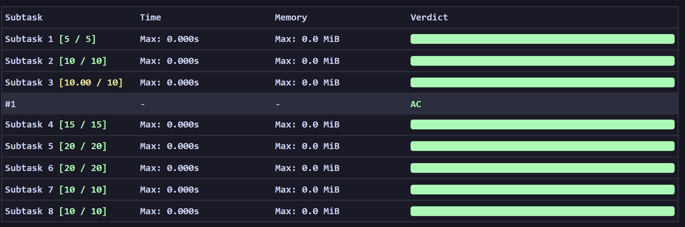
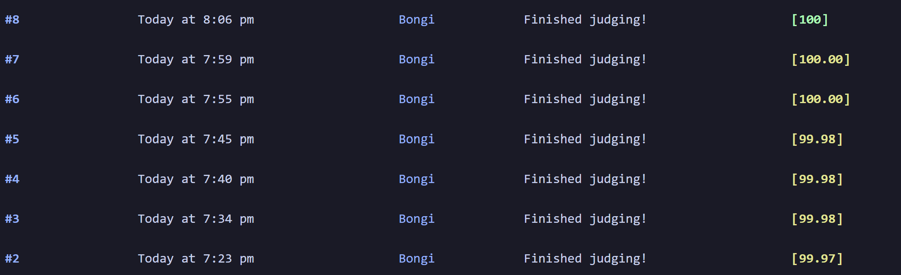

# Output-Only Tasks

A rare type of problem where you can run a heuristic solution using 12 cpu cores and avx-512 for the full time of FARIO.

I have AC'ed around 5 of them but done 9 of them to about 80% score.

Test data is probably not that useful then, so I'm just including screenshots to show how ragey they are to AC instead of 99.99 or 100.00...

Like what do u mean 100.00 isnt 100, or AC isn't AC?

